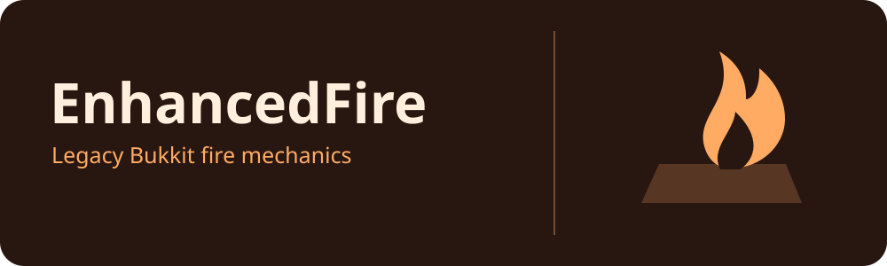

# EnhancedFire

A legacy Minecraft server plugin that changes how fire behaves: materials burn at different speeds, burned blocks can leave ash, and cauldrons can cook.

## Table of Contents

- [Overview](#overview)
- [Technologies](#technologies)
- [Getting Started](#getting-started)

## Overview

The plugin includes configurable burn times, ash, heat and cauldron cooking. See the original [project icon](promo-material/icon.png) and [default settings](src/main/resources/config.yml).

## Technologies

- [Java](https://www.java.com/)
- [Apache Maven](https://maven.apache.org/)
- [Bukkit API](https://hub.spigotmc.org/javadocs/bukkit/)

## Getting Started

The Maven manifest targets Bukkit **1.13.2**. No clean build or compatibility with current Minecraft server releases is claimed. Review `pom.xml`, `plugin.yml` and the default settings before testing on a disposable server.
